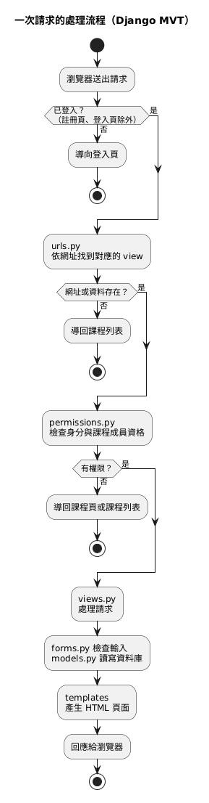

# Architecture（架構設計文件）

**Project name：** Mini Moodle
**Date：** 2026-11-11
**Version：** 0.1（草稿）
**By：** SD

本文件依據 SRS v1.0（`docs/SRS.md`）與 UML（`uml/`）描述 Mini Moodle 的架構，作為架構雛形（`src/`）的設計依據。本文件不新增、不修改 SRS 的需求；SRS 未明定、但實作時必須決定的部分，記錄於第 7 章「設計決定」。

## Table of Contents

1. 技術選型
2. 整體架構
3. 專案結構
4. 資料模型
5. 權限檢查
6. 檔案上傳與下載
7. 設計決定（SRS 未明定的部分）
8. 架構雛形範圍

---

## 1. 技術選型

SRS 未指定技術選型，由 SD 在設計階段決定（DE-4）。選擇原則為「容易理解、方便在報告時說明」。

| 項目 | 選擇 | 理由 |
| --- | --- | --- |
| 程式語言 | Python 3.12 | 語法容易閱讀 |
| 網頁框架 | Django 5.2 LTS | 一個框架即包含網址對應、頁面範本、表單驗證、登入、資料庫與檔案上傳，不需另外組合其他套件 |
| 資料庫 | SQLite | Python 內建，不需另外安裝資料庫伺服器（EIR-14.1） |
| 檔案儲存 | 伺服器本機資料夾 | 存放作業附件與繳交檔案（EIR-14.2、DE-3） |
| 頁面 | Django 範本（伺服器產生 HTML） | SRS 的畫面皆為一般表單與列表，不需要前後端分離 |
| 前端 | 一般 CSS、少量 JavaScript | JavaScript 只用於密碼顯示／隱藏（EIR-1.2、EIR-2.1）與確認對話框（EIR-12.1、EIR-12.2） |

**不使用的項目：**

| 項目 | 原因 |
| --- | --- |
| Flask 或其他網頁框架 | 與 Django 功能重疊，同時使用只會增加需要說明的內容 |
| React 等前端框架、獨立 API | SRS 沒有需要的畫面，且增加學習成本 |
| Django 內建管理後台（admin） | 本系統沒有系統管理員角色（D-29） |
| 電子郵件、第三方登入等外部服務 | 系統不依賴外部服務（EIR-14.4、DE-1、DE-2） |

**撰寫原則（方便報告說明）：**

- 每個功能一個資料夾（Django app）
- 只使用函式寫法的 view，不使用 class-based view
- 權限檢查集中在一個檔案（`common/permissions.py`）
- 程式註解標示對應的需求編號，例如 `# FR-6.1`

## 2. 整體架構

採用 Django 的 MVT 架構（Model–View–Template）。每個功能的請求都依相同路徑處理：



原始檔：`uml/puml/architecture.puml`

| 層 | 檔案 | 負責 |
| --- | --- | --- |
| 網址對應 | `urls.py` | 決定哪個網址交給哪個 view |
| 權限檢查 | `common/permissions.py` | 檢查登入狀態、身分、課程成員資格（NFR-SEC-02） |
| View | `views.py` | 接收請求、呼叫表單與資料模型、選擇要顯示的頁面 |
| Form | `forms.py` | 檢查使用者輸入，產生錯誤訊息（例如 FR-1.4、FR-3.3、FR-8.9） |
| Model | `models.py` | 定義資料表與資料規則，對應類別圖 |
| Template | `templates/` | 產生使用者看到的 HTML 頁面 |

以「發布公告」（FR-6.1）為例：

```python
@course_teacher_required                      # NFR-SEC-02：只有該課程的教師
def create_announcement(request, course_id):  # FR-6.1
    form = AnnouncementForm(request.POST or None)
    if form.is_valid():
        form.save_for(course_id)
        return redirect("course_detail", course_id)
    return render(request, "announcements/form.html", {"form": form})
```

## 3. 專案結構

```text
src/
├── manage.py                 Django 指令入口（啟動伺服器、建立資料表）
├── requirements.txt          套件清單
├── config/                   專案設定（settings.py、根網址 urls.py）
├── common/                   共用：權限檢查、PDF 檢查、密碼規則
├── accounts/                 1 註冊、2 登入
├── courses/                  3 建立與管理課程、4 加入與退出課程、5 課程成員
├── announcements/            6 公告
├── board/                    7 留言板
├── assignments/              8 作業
├── templates/                共用版面（base.html）、確認對話框
├── static/                   CSS、JavaScript
└── uploads/                  上傳的檔案（不放進 Git）
```

每個功能資料夾內的檔案相同：`models.py`、`forms.py`、`views.py`、`urls.py`、`templates/`。

| 資料夾 | 核心功能 | 對應 FR | 資料模型 | 主要畫面 |
| --- | --- | --- | --- | --- |
| `accounts` | 1 註冊、2 登入 | FR-1.x、FR-2.x | User | 註冊頁、登入頁、帳號資訊頁（EIR-1、EIR-2） |
| `courses` | 3 課程、4 加入退出、5 成員 | FR-3.x、FR-4.x、FR-5.x | Course、Enrollment | 課程列表、管理課程、建立課程、課程頁、課程設定、成員名單（EIR-3 ～ EIR-6） |
| `announcements` | 6 公告 | FR-6.x | Announcement | 公告表單；公告列表顯示於課程頁（EIR-7） |
| `board` | 7 留言板 | FR-7.x | Message | 留言板（EIR-8） |
| `assignments` | 8 作業 | FR-8.x | Assignment、Submission | 作業列表、作業內容、繳交、繳交狀況總表、批改（EIR-9 ～ EIR-11） |
| `common` | 共用 | NFR-SEC-01、NFR-SEC-02、FR-8.12、FR-8.13 | — | 確認對話框（EIR-12） |

### 3.1 網址規劃

與單一課程有關的網址都以 `/courses/<課程編號>/` 開頭，權限檢查可以直接從網址取得課程。刪除、退出、發布成績等會變更資料的操作，只能透過頁面上的按鈕與確認對話框（EIR-12.1）送出（POST），不能只靠開啟網址執行。

| 網址 | 畫面或操作 | 對應需求 |
| --- | --- | --- |
| `/register/` | 註冊 | FR-1.x |
| `/login/`、`/logout/` | 登入、登出 | FR-2.x |
| `/account/` | 帳號資訊頁（含登出按鈕） | EIR-2.3 |
| `/` | 課程列表 | FR-3.9 |
| `/courses/new/` | 建立課程（教師） | FR-3.1 ～ FR-3.4 |
| `/courses/manage/` | 管理課程：以課碼加入、退出（學生） | FR-4.1 ～ FR-4.6 |
| `/courses/<id>/` | 課程頁（課程資訊、課碼、公告） | FR-3.10、FR-3.11、FR-6.3 |
| `/courses/<id>/settings/` | 課程設定（教師） | FR-3.7、FR-3.8 |
| `/courses/<id>/members/` | 成員名單、新增學生（教師） | FR-5.x |
| `/courses/<id>/announcements/...` | 發布、編輯、刪除公告（教師） | FR-6.1、FR-6.2 |
| `/courses/<id>/board/...` | 留言板、發表、編輯、刪除留言 | FR-7.x |
| `/courses/<id>/assignments/...` | 作業列表、作業內容、建立、編輯、刪除 | FR-8.1 ～ FR-8.3 |
| `/courses/<id>/assignments/<id>/submit/` | 繳交作業（學生） | FR-8.4 ～ FR-8.6 |
| `/courses/<id>/assignments/<id>/submissions/...` | 繳交狀況總表、下載繳交檔案、批改、發布成績（教師） | FR-8.7 ～ FR-8.11、FR-8.14 |

## 4. 資料模型

資料模型與類別圖（`uml/puml/class.puml`）一致，每個類別對應一個 Django model。

| 類別 | 所在資料夾 | 重點 |
| --- | --- | --- |
| User | `accounts` | 以 `account`（學號或教職員編號）登入；`role` 為教師或學生，註冊後不可更改（FR-1.3） |
| Course | `courses` | `courseCode` 不重複；產生時若與現有課碼相同就重新產生（FR-3.5） |
| Enrollment | `courses` | 同一位學生在同一門課程只有一筆 |
| Announcement | `announcements` | 屬於一門課程 |
| Message | `board` | 屬於一門課程，記錄作者 |
| Assignment | `assignments` | 附件可為空（見 DD-4）；`gradesPublished` 記錄是否已發布成績 |
| Submission | `assignments` | 每位學生每份作業最多一筆；`isLate` 不儲存，由程式計算（見 DD-2） |

**與需求有關的關聯設計：**

- Submission 與 Message 連到 User 與課程，不連到 Enrollment。學生退出課程時只刪除 Enrollment，繳交與留言都會保留（FR-4.8）。
- 刪除 Assignment 時，一併刪除其所有 Submission（FR-8.15）。
- 系統只提供教師手動加入學生（FR-5.3），不提供教師移除學生。

## 5. 權限檢查

登入檢查使用 Django 內建的 LoginRequiredMiddleware：所有頁面預設需要登入，只有註冊頁與登入頁例外（FR-2.5）。其餘權限檢查集中在 `common/permissions.py`，以裝飾器（decorator）加在 view 上。即使頁面已隱藏某個按鈕，伺服器仍會再檢查一次，避免直接輸入網址繞過（NFR-SEC-02）。

| 檢查 | 不符合時 | 對應需求 |
| --- | --- | --- |
| 已登入 | 導向登入頁 | FR-2.5 |
| 身分為教師 | 導回課程列表 | FR-3.1 |
| 身分為學生 | 導回課程列表 | FR-4.1、FR-8.4 |
| 為該課程成員 | 導回課程列表 | FR-4.7 |
| 為該課程的教師 | 導回該課程的課程頁 | FR-3.6 ～ FR-3.8、FR-5.3、FR-6.x、FR-7.5、FR-8.x |
| 為留言作者 | 導回該課程的課程頁 | FR-7.4 |
| 網址中的公告、留言、作業、繳交屬於網址中的課程 | 導回該課程的課程頁（不是成員則導回課程列表） | FR-4.7、NFR-SEC-02 |

導回時不另外顯示訊息（見 DD-9）。最後一項檢查可避免使用者修改網址中的編號，存取或繳交到其他課程的資料。

## 6. 檔案上傳與下載

| 項目 | 設計 | 對應需求 |
| --- | --- | --- |
| 檔案限制 | 單一 PDF、10 MB 以內；副檔名須為 `.pdf`（見 DD-8），不符合時拒絕並顯示原因 | FR-8.12、FR-8.13、EIR-9.4 |
| 存放位置 | `src/uploads/`，以隨機檔名儲存，另外記錄原始檔名（類別圖的 `storedName`、`originalName`） | EIR-14.2 |
| 下載 | 檔案不直接公開，一律透過 view 檢查權限後才傳送，並以原始檔名下載 | NFR-SEC-02、FR-8.3、FR-8.7 |
| 重新繳交 | 新檔案存好後刪除舊檔案 | FR-8.6 |
| 刪除作業 | 刪除資料時一併刪除附件與所有繳交檔案（Django 刪除資料時不會自動刪除檔案，需由程式處理） | FR-8.15 |

## 7. 設計決定（SRS 未明定的部分）

以下項目 SRS 沒有寫明，但實作時必須擇一。決定原則與 SRS 相同：「實作最簡單、先做出可用系統」，且不新增 SRS 沒有的功能或畫面。

| 編號 | 項目 | 相關需求 | SRS 未明定之處 | 設計決定 | 理由 |
| --- | --- | --- | --- | --- | --- |
| DD-1 | 評分後重新繳交 | FR-8.6、FR-8.8 | 已評分的作業能否重新繳交 | 允許；保留原分數與評語，不另外標示 | FR-8.6 沒有限制；不需額外程式；與 Moodle 預設行為相同 |
| DD-2 | 遲交判斷 | FR-8.2、FR-8.5 | 修改截止時間後，遲交標記是否改變 | 不儲存遲交標記；顯示時以「繳交時間晚於目前截止時間」判斷，剛好等於截止時間不算遲交 | 修改截止時間後自動正確；與 Moodle 相同；第 6 章「遲交」定義為截止時間「之後」的繳交 |
| DD-3 | 已退出的學生 | FR-4.8、FR-8.11 | 繳交狀況總表是否列出已退出的學生 | 只列出目前的課程成員；已退出學生的資料保留，重新加入後再次顯示 | 與 Moodle 相同；資料不遺失 |
| DD-4 | 作業附件 | FR-8.1、FR-8.3、EIR-9.2 | 附件是否必填 | 選填；有附件時才顯示下載按鈕 | 教師可將題目寫在說明中；與 Moodle 相同 |
| DD-5 | 密碼規則 | NFR-SEC-01 | Django 預設另有密碼規則（例如拒絕常見密碼） | 只使用 NFR-SEC-01 的規則，關閉 Django 預設的其他規則 | 避免拒絕 SRS 允許的密碼 |
| DD-6 | 密碼儲存與登入逾期 | SRS 4.1、EIR-15.2 | SRS 4.1 寫明本版不設定 | 使用 Django 預設：密碼以雜湊儲存，登入狀態兩週後逾期；不另外設定 | 不新增 SRS 沒有的要求；類別圖已使用 `passwordHash` |
| DD-7 | 時區 | FR-8.5 | 截止時間與繳交時間使用的時區 | 台灣時間（Asia/Taipei） | 使用者皆在台灣 |
| DD-8 | PDF 判斷方式 | FR-8.12、FR-8.13 | 如何判斷檔案「不是 PDF」 | 以副檔名判斷，只接受 `.pdf` | Django 的標準做法，與 Moodle 相同；實作最簡單 |
| DD-9 | 沒有權限或頁面不存在時的處理 | NFR-SEC-02、EIR-12.4 | 只寫「拒絕該操作」，沒有寫畫面如何呈現；也沒有寫網址不存在時如何處理 | 不顯示錯誤頁，直接導回：課程成員導回該課程的課程頁，其他情況（含網址不存在、資料已刪除）導回課程列表；未登入仍依 FR-2.5 導向登入頁 | 正常操作看不到沒有權限的按鈕，只有手動輸入網址才會發生；不需新增錯誤頁面；Django 預設的錯誤頁為英文，不符合 EIR-12.4 |

## 8. 架構雛形範圍

架構雛形的目的是確認上述架構可以運作，不是完成所有功能。

**包含：**

- 可啟動的 Django 專案與第 3 章的資料夾結構
- 第 4 章所有資料模型與資料表
- `common/permissions.py` 的所有權限檢查
- 第 3.1 節所有網址，以及每個畫面的基本頁面
- 共用版面、確認對話框、密碼顯示／隱藏
- 一條完整可操作的流程：註冊 → 登入 → 建立課程 → 以課碼加入課程 → 上傳 PDF 並透過權限檢查下載。這條流程涵蓋最容易出問題的部分：自訂使用者、權限、課碼產生、檔案處理
- 上述流程的自動化測試
- `src/` 的執行說明

**不包含：** 其餘功能的完整實作，留待實作階段依本文件完成。
